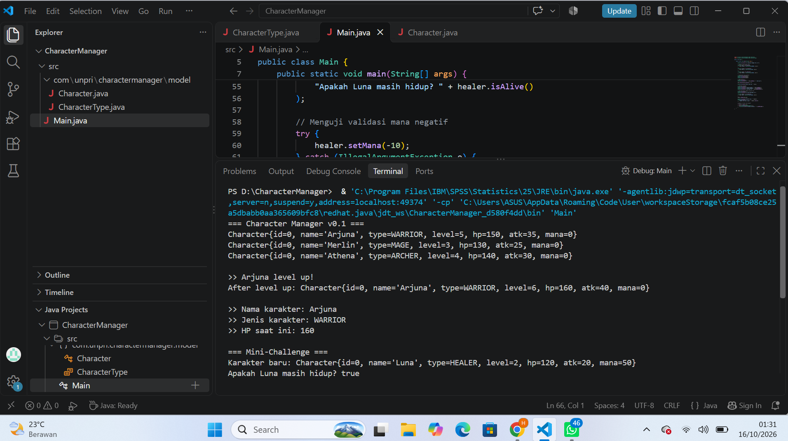
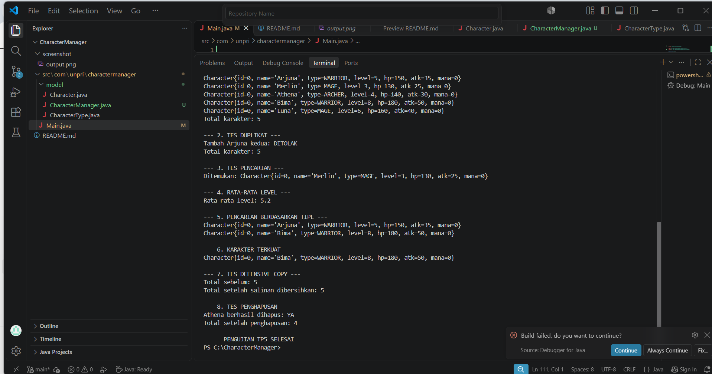
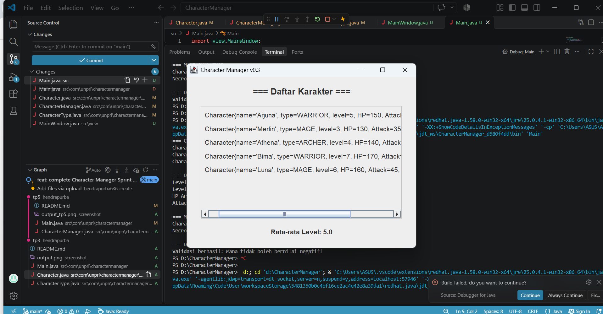

# Character Manager — TP3 (Java Visual SIH-6406)

## Deskripsi Project

Character Manager adalah program berbasis Java yang digunakan untuk mengelola data karakter dalam sebuah aplikasi sederhana. Program ini menerapkan konsep Object-Oriented Programming (OOP), seperti encapsulation, constructor, enum, getter dan setter, serta method untuk mengelola atribut karakter.

Pada TP3 ini, program dikembangkan dengan menambahkan atribut `mana`, validasi nilai mana, dan method `isAlive()` untuk memeriksa apakah karakter masih hidup berdasarkan nilai hit points (HP).

## Fitur

- Membuat objek karakter menggunakan dua constructor.
- Menggunakan `CharacterType` untuk menentukan jenis karakter.
- Mengelola atribut karakter menggunakan encapsulation.
- Melakukan perubahan level karakter.
- Menghitung kembali HP dan attack berdasarkan level.
- Menyimpan atribut `mana` dengan validasi agar tidak bernilai negatif.
- Memeriksa status hidup karakter menggunakan `isAlive()`.
- Menampilkan informasi karakter menggunakan `toString()`.

## Screenshot Output Program

Berikut adalah bukti hasil program Character Manager yang dijalankan melalui terminal.



*Catatan: Ganti gambar di atas dengan screenshot terminal milikmu yang menampilkan tiga karakter, demo level up, serta hasil pemanggilan `isAlive()`.*

## Struktur Folder Project

```text
CharacterManager/
├── src/
│   ├── com/
│   │   └── unpri/
│   │       └── charactermanager/
│   │           └── model/
│   │               ├── Character.java
│   │               └── CharacterType.java
│   └── Main.java
├── screenshots/
│   └── output.png
└── README.md
```

*Catatan: Struktur di atas merupakan contoh. Sesuaikan dengan struktur folder project yang benar-benar kamu gunakan.*

## Identitas Mahasiswa

- **Nama Lengkap:** [Hendra Lampita Purba]
- **NIM:** [253303621272]
- **Kelas:** [3 Pagi B]
- **Mata Kuliah:** Java Visual SIH-6406


## Dokumentasi Analisis Desain

Dokumen analisis desain dan ekosistem Java untuk Bagian D dapat diakses melalui Google Docs berikut:

https://docs.google.com/document/d/1R-qgvV7pJYBEpoJwBTIROjb3eyhRu5bwnFcKhvuADbQ/edit?usp=sharing


# TP5 — Character Manager

## A. Implementasi Core

Pada TP5, aplikasi Character Manager dikembangkan menggunakan Java dengan konsep Object-Oriented Programming (OOP).

Fitur yang dikerjakan:
- `equals()` membandingkan karakter berdasarkan nama.
- `addCharacter()` menambahkan karakter.
- `findByName()` mencari karakter berdasarkan nama.
- `removeCharacter()` menghapus karakter berdasarkan nama.
- `getTotalCharacters()` menghitung jumlah karakter.
- `getAllCharacters()` mengembalikan salinan daftar karakter.
- Nama karakter duplikat ditolak.

## B. Mini-Challenge

### 1. getAverageLevel()

Menghitung rata-rata level semua karakter. Jika daftar kosong, method mengembalikan `0` untuk menghindari pembagian dengan nol.

### 2. findByType(CharacterType type)

Mencari semua karakter berdasarkan tipe, seperti `WARRIOR`, `MAGE`, dan `ARCHER`.

## C. Fitur Analitik Rancangan Sendiri

### findStrongest()

Method `findStrongest()` mencari karakter dengan nilai attack power tertinggi.

Method ini membandingkan attack power setiap karakter dan mengembalikan karakter dengan nilai tertinggi. Jika daftar kosong, method mengembalikan `null`.

Fitur ini memudahkan pengguna mengetahui karakter dengan serangan paling kuat.

## D. Pengujian Program

Pengujian dilakukan melalui `Main.java`, meliputi:

1. Menambahkan karakter.
2. Menolak nama duplikat.
3. Mencari karakter berdasarkan nama.
4. Menghitung rata-rata level.
5. Mencari karakter berdasarkan tipe.
6. Mencari karakter terkuat.
7. Menguji defensive copy.
8. Menghapus karakter.

### Screenshot Output TP5

Berikut hasil pengujian program Character Manager TP5.

## Screenshot Output TP5




## E. Analisis Reference dan Rancangan

Analisis dibuat dalam Google Docs dengan pembahasan:

- Perbedaan reference dan primitive value.
- Perilaku `a == b` pada objek Java.
- Fungsi variabel `static`.
- Penggunaan `equals()` untuk membandingkan nama karakter.
- Risiko mengembalikan ArrayList asli.
- Pentingnya defensive copy dan encapsulation.

**Link Google Docs:** https://docs.google.com/document/d/1S60qNP8OS_x9-JDbXr7FKg7BFrEI1UnHa7W4CokkDWQ/edit?usp=sharing

## Teknologi

- Java
- Visual Studio Code
- Git dan GitHub

## TP8 – Character Manager GUI & MVC

### 1. Screenshot MainWindow

Screenshot berikut menunjukkan aplikasi Character Manager yang menampilkan minimal 5 karakter beserta statistik rata-rata level.

[]

### 2. Aliran Data dan Penerapan MVC

Aliran data dimulai dari Main.java yang membuat objek CharacterManager dan menambahkan data karakter. Selanjutnya, CharacterManager menyimpan dan mengelola seluruh data karakter menggunakan ArrayList. MainWindow menerima objek CharacterManager untuk menampilkan daftar karakter secara dinamis serta statistik rata-rata level pada GUI. Dalam konsep MVC, CharacterManager berperan sebagai Model, MainWindow sebagai View, sedangkan Main.java mengatur proses awal aplikasi dan menghubungkan Model dengan View.

### 3. Karakter Baru

Berikut adalah karakter baru yang ditambahkan pada TP8:

| Nama Karakter | Tipe | Level | Alasan Pemilihan |
|---|---|---|---|
| [Karakter baru 1] | [Tipe] | [Level] | [Alasan] |
| [Karakter baru 2] | [Tipe] | [Level] | [Alasan] |

### 4. Link Google Docs – Bagian D

Dokumentasi analisis GUI dan MVC dapat dilihat melalui link Google Docs berikut:

https://docs.google.com/document/d/1fkfzwVjK17aURpChZRXZLctBwW-eVeEF3cLVGIiAJfI/edit?usp=sharing