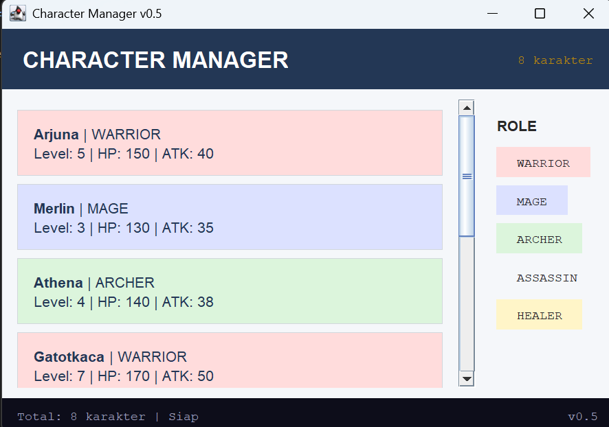
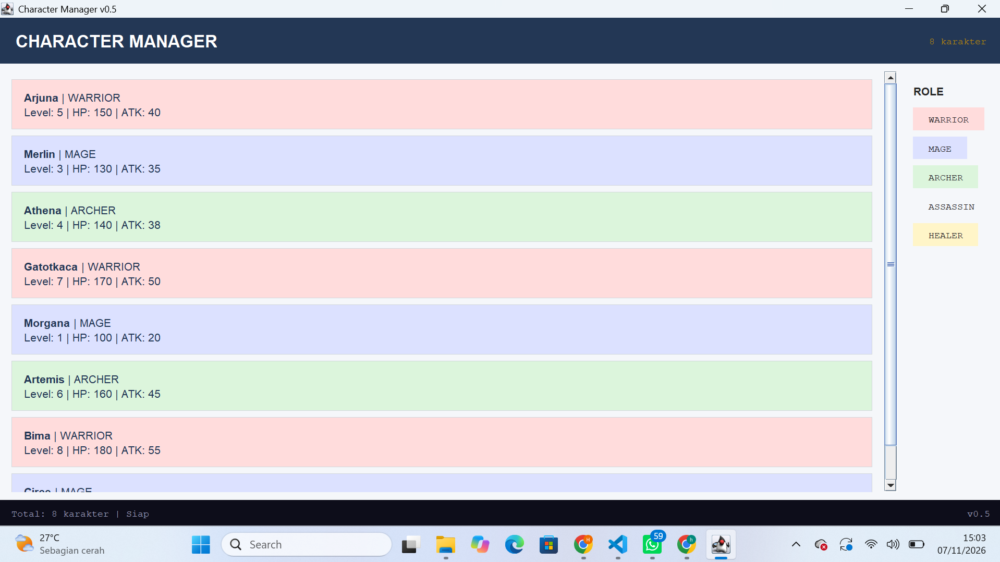
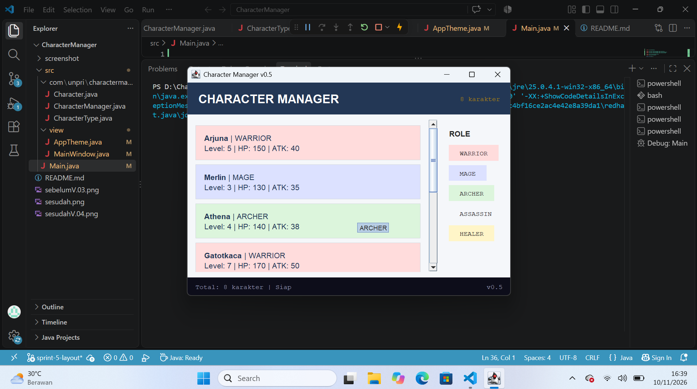

## TP12 — Character Manager v0.5

### A. Wireframe Tampilan Aplikasi

Berikut rancangan tata letak aplikasi Character Manager v0.5:

```text
+------------------------------------------------------+
|              HEADER (NORTH)                          |
|  Character Manager                    8 Karakter     |
+------------------------------------------------------+
|                                                      |
|  PANEL STATISTIK (PANEL TAMBAHAN)                    |
|  Total Karakter | Rata-rata Level                    |
|                                                      |
+-----------------------------------+------------------+
|                                   |                  |
|  DAFTAR KARAKTER (CENTER)         |  LEGENDA (EAST)  |
|  +-----------------------------+  |                  |
|  | Arjuna - WARRIOR            |  |  WARRIOR         |
|  +-----------------------------+  |  MAGE            |
|  | Merlin - MAGE               |  |  ARCHER          |
|  +-----------------------------+  |  HEALER          |
|  | Athena - ARCHER             |  |                  |
|  +-----------------------------+  |                  |
|  | ...                         |  |                  |
|  +-----------------------------+  |                  |
|           SCROLLBAR              |                  |
+-----------------------------------+------------------+
|  Total: 8 karakter       Siap              v0.5      |
+------------------------------------------------------+
```

### B. Screenshot Aplikasi

**1. Tampilan Ukuran Awal**



**2. Tampilan Jendela Dilebarkan**



**3. Tampilan Jendela Dikecilkan**



### C. Tabel Pengamatan Resize

| Kondisi | Prediksi | Hasil Pengamatan |
|---|---|---|
| Ukuran awal | Semua panel tampil sesuai posisi masing-masing. | Sesuai, panel tampil dengan rapi. |
| Jendela dilebarkan | Area CENTER mendapatkan ruang lebih luas. | Daftar karakter memiliki ruang lebih besar. |
| Jendela dikecilkan | Area daftar menjadi lebih sempit dan scrollbar muncul jika diperlukan. | Scrollbar muncul ketika daftar tidak muat. |

### D. Struktur Panel Bersarang

Aplikasi Character Manager v0.5 menggunakan BorderLayout sebagai layout utama untuk membagi tampilan menjadi beberapa wilayah. Pada bagian NORTH terdapat panel header dan panel statistik sebagai panel tambahan. Bagian CENTER berisi JScrollPane yang menampung panel daftar karakter, sedangkan bagian EAST berisi panel legenda dengan BoxLayout. Pada bagian SOUTH terdapat status bar yang menampilkan jumlah karakter, status aplikasi, dan versi aplikasi.

### E. Alasan Pemilihan Panel Tambahan dan Layout

Panel tambahan yang digunakan adalah panel statistik dengan GridLayout 2x2. Layout ini dipilih karena dapat menyusun informasi statistik secara teratur dengan ukuran komponen yang sama. Informasi seperti total karakter dan rata-rata level dapat ditampilkan dengan lebih rapi.

Layout yang tidak dipilih adalah FlowLayout karena susunan komponennya dapat berpindah baris ketika ukuran panel berubah. Untuk panel statistik, GridLayout lebih sesuai karena posisi informasi tetap terstruktur dan mudah dibaca.

### F. Analisis Layout & MVC (Bagian D)

Dokumen analisis lengkap mengenai Layout Manager dan Model View Controller (MVC) dapat diakses melalui Google Docs berikut:

**Nama Dokumen:** JavaVisual_TP12_[253303621272]_Hendra_Lampita_Purba

**Link Google Docs:https://docs.google.com/document/d/12g-T1RPf5JA4j2xEdNSSYXEo5AWP-GoomvTfBacAwug/edit?usp=sharin

**Akses:** Anyone with the link — Viewer