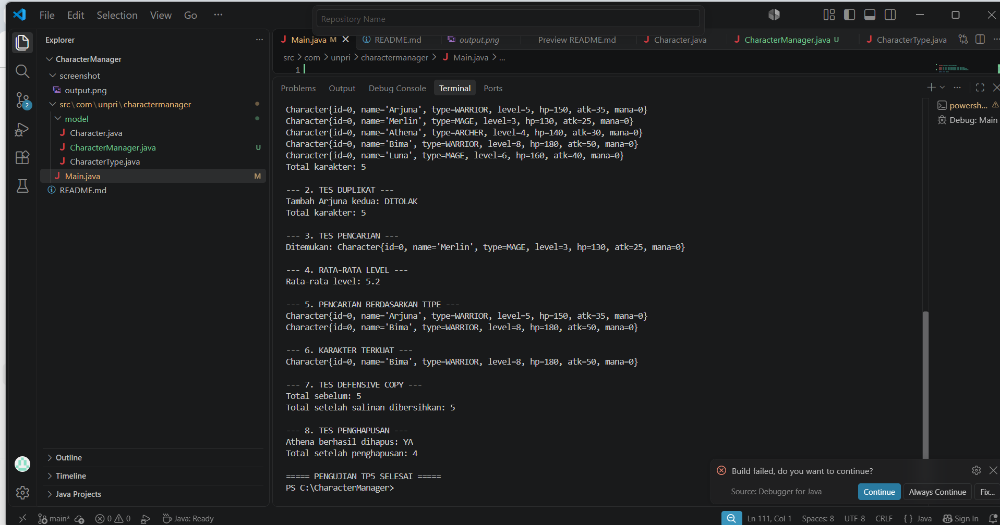

# TP5 — Character Manager

## A. Implementasi Core

Pada TP5, aplikasi Character Manager dikembangkan menggunakan Java dengan konsep Object-Oriented Programming (OOP).

Fitur yang dikerjakan:
- `equals()` membandingkan karakter berdasarkan nama.
- `addCharacter()` menambahkan karakter.
- `findByName()` mencari karakter berdasarkan nama.
- `removeCharacter()` menghapus karakter berdasarkan nama.
- `getTotalCharacters()` menghitung jumlah karakter.
- `getAllCharacters()` mengembalikan salinan daftar karakter.
- Nama karakter duplikat ditolak.

## B. Mini-Challenge

### 1. getAverageLevel()

Menghitung rata-rata level semua karakter. Jika daftar kosong, method mengembalikan `0` untuk menghindari pembagian dengan nol.

### 2. findByType(CharacterType type)

Mencari semua karakter berdasarkan tipe, seperti `WARRIOR`, `MAGE`, dan `ARCHER`.

## C. Fitur Analitik Rancangan Sendiri

### findStrongest()

Method `findStrongest()` mencari karakter dengan nilai attack power tertinggi.

Method ini membandingkan attack power setiap karakter dan mengembalikan karakter dengan nilai tertinggi. Jika daftar kosong, method mengembalikan `null`.

Fitur ini memudahkan pengguna mengetahui karakter dengan serangan paling kuat.

## D. Pengujian Program

Pengujian dilakukan melalui `Main.java`, meliputi:

1. Menambahkan karakter.
2. Menolak nama duplikat.
3. Mencari karakter berdasarkan nama.
4. Menghitung rata-rata level.
5. Mencari karakter berdasarkan tipe.
6. Mencari karakter terkuat.
7. Menguji defensive copy.
8. Menghapus karakter.

### Screenshot Output TP5

Berikut hasil pengujian program Character Manager TP5.

## Screenshot Output TP5

## E. Analisis Reference dan Rancangan

Analisis dibuat dalam Google Docs dengan pembahasan:

- Perbedaan reference dan primitive value.
- Perilaku `a == b` pada objek Java.
- Fungsi variabel `static`.
- Penggunaan `equals()` untuk membandingkan nama karakter.
- Risiko mengembalikan ArrayList asli.
- Pentingnya defensive copy dan encapsulation.

**Link Google Docs:** https://docs.google.com/document/d/1S60qNP8OS_x9-JDbXr7FKg7BFrEI1UnHa7W4CokkDWQ/edit?usp=sharing

## Teknologi

- Java
- Visual Studio Code
- Git dan GitHub