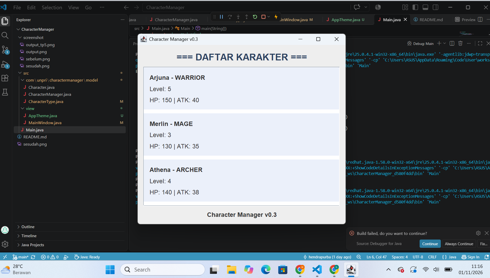
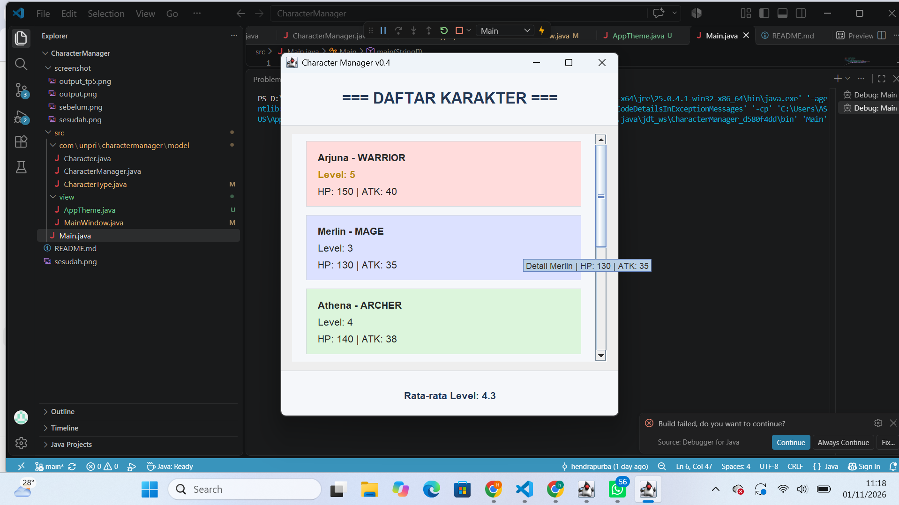

## TP10 — AppTheme dan MainWindow v0.4

### 1. Screenshot Sebelum dan Sesudah

**Sebelum (MainWindow v0.3)**

Tampilan aplikasi Character Manager sebelum menggunakan AppTheme.

**Sesudah (MainWindow v0.4)**

Tampilan aplikasi setelah menggunakan AppTheme dengan warna kartu sesuai role, level tinggi berwarna emas, dan enam karakter.

### 2. Pemisahan Warna dengan Model (MVC)

Warna aplikasi disimpan di AppTheme karena pengaturan warna merupakan bagian dari tampilan (View), bukan data karakter (Model). Class Character hanya bertanggung jawab menyimpan informasi karakter seperti nama, role, level, HP, dan Attack Power. Dengan memisahkan pengaturan warna ke AppTheme, perubahan desain tidak perlu mengubah class Character. Hal ini membuat kode lebih rapi, konsisten, dan mudah dikembangkan.

### 3. Dua Properti Tambahan

**1. Tooltip HP dan ATK**

Menampilkan informasi HP dan Attack Power ketika kursor diarahkan ke kartu karakter. Fitur ini membantu pengguna melihat detail karakter dengan lebih mudah.

**2. Karakter Level 1 Dinonaktifkan**

Menggunakan setEnabled(false) untuk karakter dengan level 1. Tujuannya agar karakter level paling rendah memiliki tampilan dan status yang berbeda dari karakter lainnya.

### 4. Google Docs — Analisis Bagian D

https://docs.google.com/document/d/15vX5OjsXgsOJJd_dakHPVbyGZffWl3C9t381OXTAyDk/edit?usp=sharing