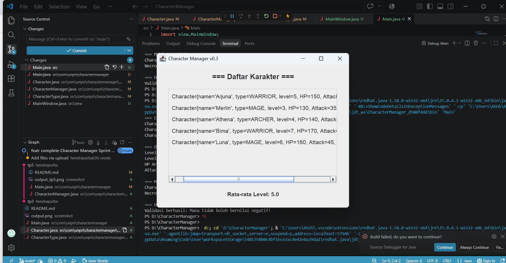

## TP8 – Character Manager GUI & MVC

### 1. Screenshot MainWindow

Screenshot berikut menunjukkan aplikasi Character Manager yang menampilkan minimal 5 karakter beserta statistik rata-rata level.

[]

### 2. Aliran Data dan Penerapan MVC

Aliran data dimulai dari Main.java yang membuat objek CharacterManager dan menambahkan data karakter. Selanjutnya, CharacterManager menyimpan dan mengelola seluruh data karakter menggunakan ArrayList. MainWindow menerima objek CharacterManager untuk menampilkan daftar karakter secara dinamis serta statistik rata-rata level pada GUI. Dalam konsep MVC, CharacterManager berperan sebagai Model, MainWindow sebagai View, sedangkan Main.java mengatur proses awal aplikasi dan menghubungkan Model dengan View.

### 3. Karakter Baru

Berikut adalah karakter baru yang ditambahkan pada TP8:

| Nama Karakter | Tipe | Level | Alasan Pemilihan |
|---|---|---|---|
| [Karakter baru 1] | [Tipe] | [Level] | [Alasan] |
| [Karakter baru 2] | [Tipe] | [Level] | [Alasan] |

### 4. Link Google Docs – Bagian D

Dokumentasi analisis GUI dan MVC dapat dilihat melalui link Google Docs berikut:

https://docs.google.com/document/d/1fkfzwVjK17aURpChZRXZLctBwW-eVeEF3cLVGIiAJfI/edit?usp=sharing